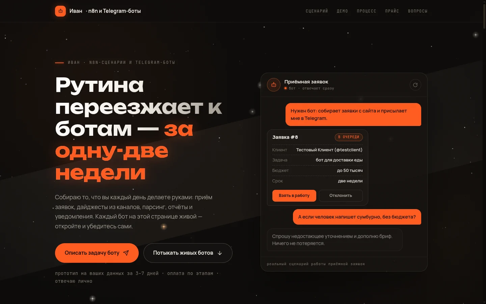
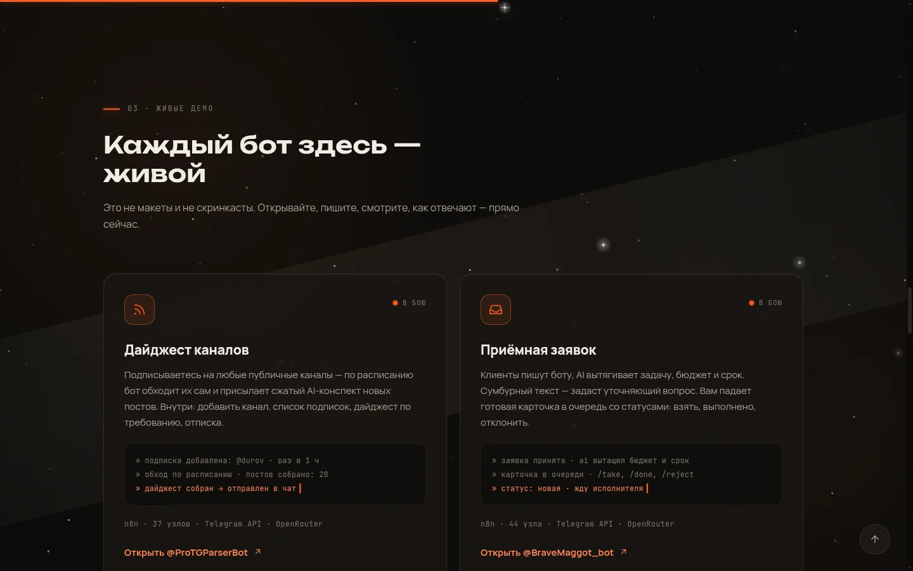
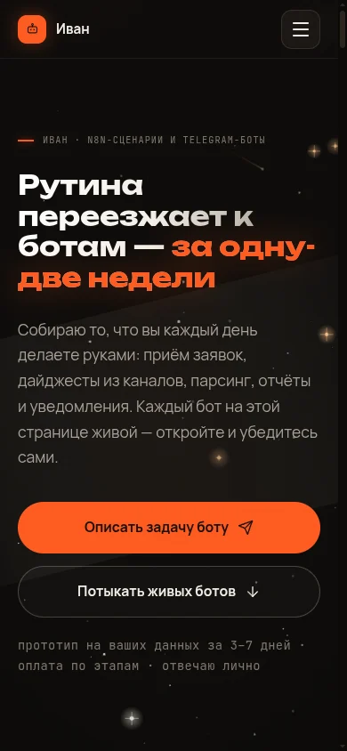
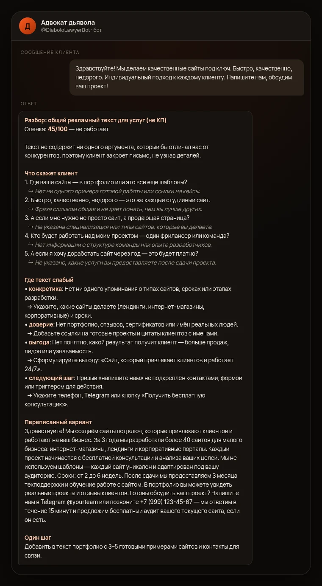
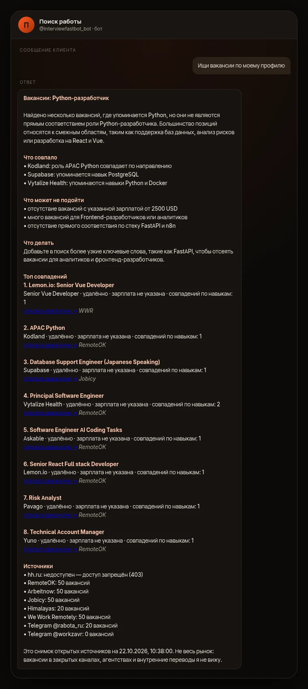

# Портфолио bravemaggot — живой индекс

Обновлено: 2026-10-22 (вечер). Статусы: 🟢 живое и проверенное · 🟡 построено, ждёт токен/тест

## Лендинг (живой)
- 🟢 https://bravemaggot.github.io — «Рутина переезжает к ботам — за одну-две недели». Одностраничник, всё в одном файле: `index.html` + `fonts/` + `og.png` + `privacy.html` + `404.html`.
- Дизайн: ночное небо на canvas со звёздами и метеорами, оранжевый акцент `#ff5a1f` на угольном `#0c0a08`, крупный дисплейный Unbounded, Manrope в тексте, JetBrains Mono в метках.
- **Шрифты свои** (`fonts/*.woff2`, 6 файлов, 158 КБ): Unbounded 500–700, Manrope 400–800, JetBrains Mono 400–600, кириллица включена. Внешних запросов к Google нет — заявление «сайт ничего не собирает» в подвале правдиво.
- Интерактив: калькулятор рутины в часах, конструктор сценария из трёх шагов с живым пересчётом бюджета и срока, мини-чат с реальной карточкой заявки, FAQ-аккордеон, 3D-наклон карточек, boot-экран, курсор-кольцо, прогресс-бар прокрутки.
- Демо-блоки — **живые боты**: парсер `@ProTGParserBot`, приёмная `@BraveMaggot_bot`, критик офферов `@DiaboloLawyerBot`, поиск работы `@Interviewfastbot_bot`. Приёмная дополнительно работает как способ связаться со мной: на неё ведут все основные CTA.
- Цены на странице — рыночные ориентиры: 15 000 ₽ за один сценарий, 50 000 ₽ за бота целиком, 10 000 ₽/мес за сопровождение.
- Предыдущая версия (тёмно-зелёная, v1) осталась в истории репозитория (коммит `41d06f4`) и в `~/Work/portfolio-v1-archive/`.

### Прайс (выставлен по рынку 2026-10-22)
- Точечная автоматизация (один сценарий n8n) — **от 15 000 ₽**
- Бот под ключ (сценарии + AI) — **от 50 000 ₽**
- Сопровождение — **от 10 000 ₽/мес**

Обоснование и источники — в разделе «Прайс: как выставлены цены» ниже.

### Что осталось заменить автору
1. **Ссылки на код-ботов** — уже проставлены на живые ники (`@DiaboloLawyerBot`, `@Interviewfastbot_bot`).
2. **Юзернейм «Поиска работы»** — в лендинге стоит старый `@Interviewfastbot_bot`, переименование через BotFather не сделано.
3. **Отзывы / кейсы** — на странице их нет: подтверждённых результатов пока нет, выдумывать нельзя. Добавлять по мере появления реальных.
4. **Мини-консоли** в демо-карточках — это реальные выводы живых запусков, но скриншотами интерфейса их можно заменить позже.

## Прайс: как выставлены цены

Цены выставлены **2026-10-22 по результатам исследования рынка РФ (сентябрь–октябрь 2026)**. Позиционирование: **верхняя граница фриланса / нижняя граница студии** — с живыми кейсами, соло, но без демпинга биржевых шаблонов.

| Тариф | Цена | Рынок РФ | Ориентиры |
|---|---|---|---|
| Точечная автоматизация (один сценарий n8n) | **от 15 000 ₽** | 15 000–40 000 ₽ у специалистов; 3 900–15 600 ₽ в магазине FL.ru (демпинг) | kalinkindev.ru: простой сценарий от 15–25 тыс.; bot-craft.ru: простая задача от 15 000 |
| Бот под ключ (сценарии + AI) | **от 50 000 ₽** | 30 000–70 000 ₽ за бота с AI; 60 000–150 000 ₽ за под ключ с БД/админкой | sozdaibota.ru: от 50 000 (GPT-4); roboweb.team: 50 000; Kompaniec: от 70 000 |
| Сопровождение | **от 10 000 ₽/мес** | 3 000–6 000 ₽ базовый, 10 000–15 000 ₽ норма, 24 000–76 000 ₽ студии | BotZayavki: 3/6/10 тыс.; Kompaniec: от 10 000; app72: 10–15 % от цены разработки в месяц |

Ставка на рынке: 800–1 500 ₽/ч — низ, **2 500 ₽/ч — норма**, 3 500–5 000 ₽/ч — студия. Один сценарий = 4–10 часов, поэтому 15 000 ₽ — это нижняя граница, при которой ещё можно тестировать сбойные ветки и писать документацию.

Инфраструктура на клиента: self-hosted n8n — 0 ₽ за софт, VPS 500–2 000 ₽/мес, OpenRouter — сбор 5,5 % с токенов, Telegram API — бесплатно. То есть деньги в работе, не в подписках: чек ниже ~15 000 ₽ не окупает даже 5 часов.

Источники: [FL.ru — магазин услуг n8n](https://www.fl.ru/uslugi-freelancera/n8n), [Kwork — n8n](https://kwork.ru/script-programming/47817164/avtomatizatsiya-na-n8n), [Kalinkindev — настройка n8n под задачу, цена](https://kalinkindev.ru/blog/nastroika-n8n-pod-zadachu-cena), [BotCraft — n8n automation 2026](https://bot-craft.ru/blog/n8n-automation-2026), [Компаниец — Telegram-боты](https://kompaniec.com/telegram-bot), [Roboweb — Telegram-бот под ключ](https://roboweb.team/telegram-bot/), [Создай бота — цены](https://sozdaibota.ru/), [BotZayavki — тарифы сопровождения](https://botzayavki.ru/), [app72 — сколько стоит чат-бот в Telegram 2026](https://app72.ru/blog/13281-skolko-stoit-chat-bot-telegram-2026-5), [TGBotKrafT — ставки](https://www.tgbotkraft.ru/), [Upwork — ставки n8n](https://www.upwork.com/hire/n8n-experts/), [OpenRouter — тарифы](https://openrouter.ai/pricing), [n8n — тарифы хостинга](https://n8n.io/pricing).

> Данные рынка — это заявленные вилки и бюджеты заказов, а не закрытые сделки: официальной статистики по среднему чеку в РФ не существует. Цены на лендинге — нижняя граница; точную всегда называю после разговора.

## n8n-сервисы (локальный n8n 2.43.4, Tailscale)
| Сервис | Workflow id | Статус | Что делает |
|---|---|---|---|
| Парсер TG-каналов | d4kkVX59SOUCfWYl | 🟢 активен, свой бот @ProTGParserBot, последний exec 427/success | Подписки на публичные каналы (/add /list /now /remove), AI-дайджест новых постов по расписанию (t.me/s парсинг + OpenRouter) |
| Приёмная заказов | pINzXMMWsysTHGKa | 🟢 активен, свой бот @BraveMaggot_Bot, последний exec 420/success | Клиенты пишут боту → AI структурирует бриф → карточка владельцу, очередь /orders /take /done /reject |

Артефакты: `~/Work/workflows/v3/` (build_parser.py, parser.json, build_orders.py, orders.json).
Дата-таблицы: tg_channels (7ASD9juyPenGn95T), orders (rw3UAeFRH7LT7Yv0), orders_config (t3mKcx8ojGwi72Nx).

## Код-боты (grammY + OpenRouter, локальный systemd)
Оба переписаны с нуля 22.10, работают под systemd (`Restart=always`, автозапуск через `default.target`), состояние в `node:sqlite`, модель — цепочка из **пяти** бесплатных через OpenRouter.

Цепочка на 22.10.2026 (проверена живыми запросами, все отдают JSON с `finish_reason: stop`):
`nvidia/nemotron-3-ultra-550b-a55b:free` → `nvidia/nemotron-3.5-super-vl:free` → `dots-studio/dots-3-note-preview:free` → `poolside/laguna-s-2.1:free` → `cohere/north-mini-code:free`. Задаётся в `OPENROUTER_MODELS` (`.env`) с дефолтом в `src/config.js`.

> **22.10.2026 — ротация моделей.** OpenRouter закрыл бесплатный период MiniMax M3.1 Flash ровно в эту дату, `gemma-4-26b` отдавала `Provider returned error`, `flint-v1.0` возвращал пустой `content` с `finish_reason: length`. Бот получал «Модель вернула пустой ответ». Цепочка заменена на пять проверенных. Проверка новых моделей — по 17 бесплатным из `GET /api/v1/models` одним запросом каждая.

| Бот | Папка | Юнит | Статус | Что делает |
|---|---|---|---|---|
| Адвокат дьявола | ~/Work/bot-devils-advocate | `tgbot-devils-advocate` | 🟢 живой, отвечает (8 разборов в транскрипте) | Критик коммерческих текстов (КП, скрипт, договор, пост): 5 возражений клиента, слабые места, чего не хватает, переписанный вариант. Кнопки «Ещё жёстче», «Как отвечать», «Переписать», «Кто мой клиент». |
| Поиск работы | ~/Work/bot-jobradar | `tgbot-jobradar` | 🟢 живой, отвечает | Ищет вакансии в 7 открытых источниках (hh.ru, RemoteOK, Arbeitnow, Jobicy, Himalayas, WWR, Telegram-каналы), разбирает профиль, честно пишет, что нашёл и какие источники недоступны. Сводка валидируется: выдуманная ссылка или число → детерминированный ответ. |

- Юзернейм второго бота пока старый (`@Interviewfastbot_bot`) — переименование только через BotFather, это действие пользователя.
- Старый бот «Собеседатель» (`~/Work/bot-interviewer`) вытеснен новым, папка осталась как архив.
- **Живое доказательство**: selftest через настоящий `bot.handleUpdate()` → реальный вызов OpenRouter (`nvidia/nemotron-3-ultra-550b-a55b:free`) и реальная доставка в Telegram (HTTP 200, ok=true). Логи: `data/transcript.jsonl` в каждой папке.

## Скриншоты

**Лендинг, 1440px — первый экран**

**Лендинг, 1440px — секция «живые демо»**

**Лендинг, 390px**

**Адвокат дьявола — реальный разбор коммерческого письма**

**Поиск работы — реальная сводка вакансий с честным списком источников**

Лендинг — настоящие скриншоты живого сайта. Карточки ботов — **реальные ответы из `data/transcript.jsonl`, отрендеренные в макет чата** (не скриншоты Telegram: клиента на этой машине нет). Текст ответов не редактировался.

## Удалено по решению пользователя
- Воркфлоу «Игра» (RPG-бот) — бэкап: ~/Work/workflows/backup-game-2026-10-21.json

## Ждёт от пользователя
1. Переименовать `@Interviewfastbot_bot` через BotFather под новую концепцию («Поиск работы») и обновить ссылку в `index.html` лендинга.
2. Перевести парсер на `@Proparser_bot` — нужен токен нового бота (сейчас работает `@ProTGParserBot`).
3. Решить, чем заменить старый «Собеседатор» в архиве `~/Work/bot-interviewer` (удалить или оставить).

~~Нажать `/start` в `@DiaboloLawyerBot`~~ — сделано, бот отвечает.
